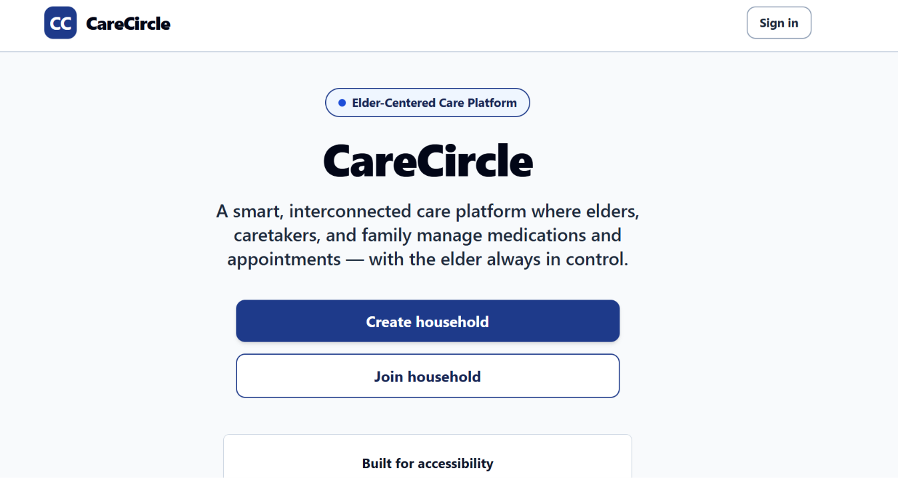
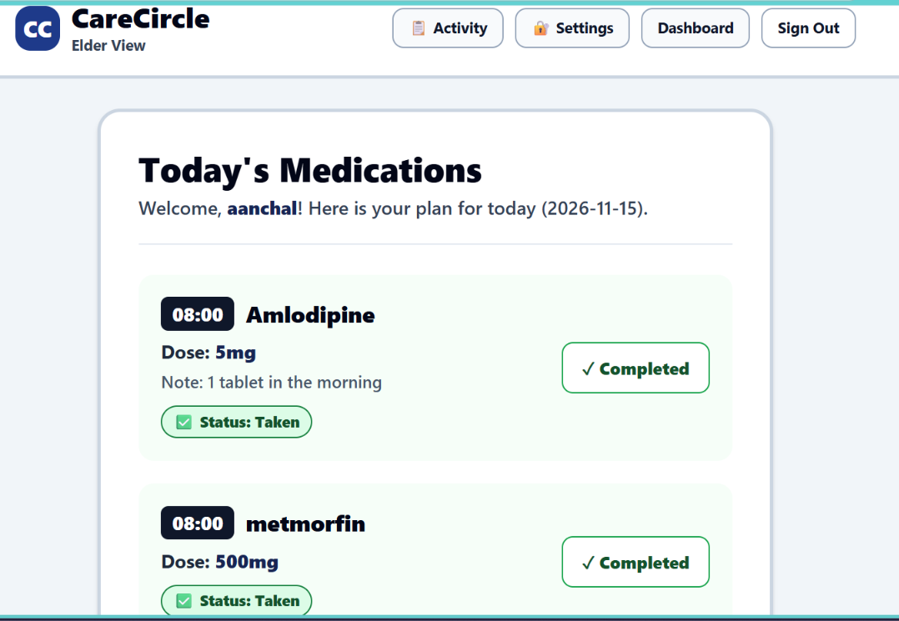
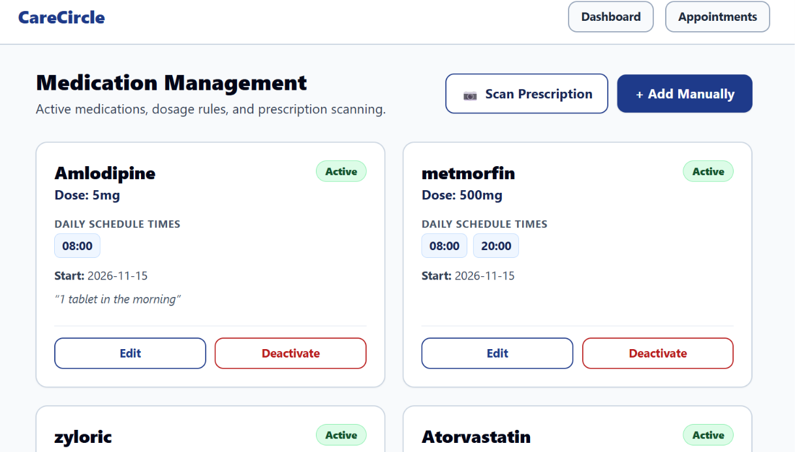
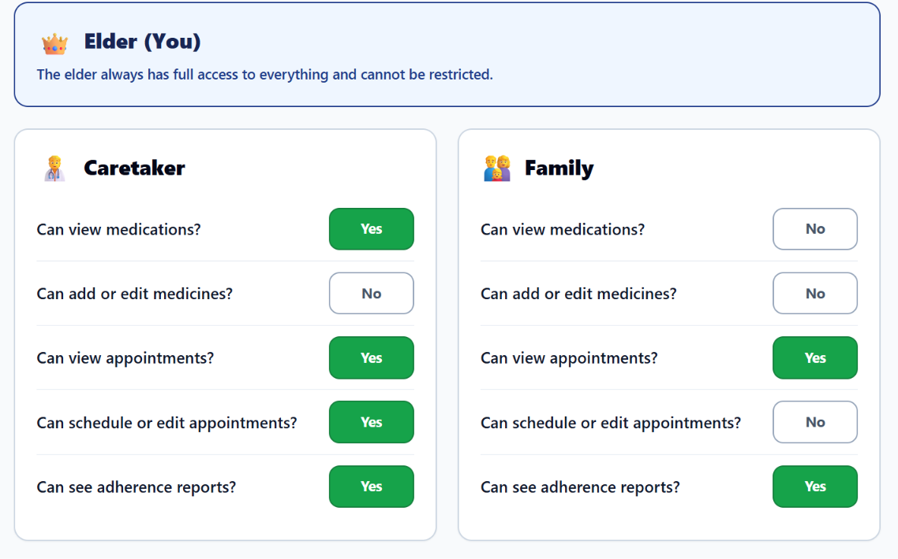
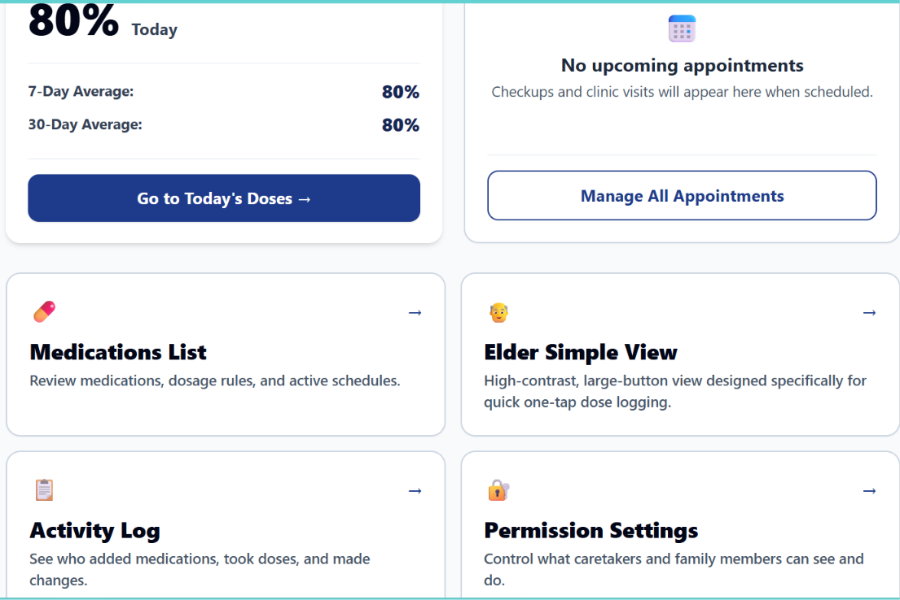

# CareCircle

**An elder-first care platform where elders, caretakers and family manage medications and appointments together, and the elder always stays in control.**

Built solo for the Catalyst Hackathon (PromptWars x Catalyst, powered by Google for Developers).

- **Live demo:** [LIVE_URL, e.g. https://carecircle-navy.vercel.app]
- **Repository:** [https://github.com/iamshubham18/carecircle.git]

## Demo access (sample data only)

Open the live link, choose **Sign in**, and use:

| Role | Household code | Email | PIN |
|---|---|---|---|
| Elder | [A89UTHRY] | [sv9900771@gmail.com] | [1234] |
| Caretaker | [A89UTHRY] | [shubhamkverma18@gmail.com] | [2345] |
| Family | [A89UTHRY] | [example@gmail.com] | [3456] |

Or create your own household from the landing page. On the Medications page, click **Scan prescription > Try with sample** to see the Gemini scan in one click.

## Screenshots







## The problem

Elderly people often juggle many medicines and appointments, while their families worry about missed doses. Most reminder apps are simple alarms: they don't involve caretakers, and they treat the elder as someone to be monitored rather than someone who makes their own healthcare decisions.

## How CareCircle answers the problem statement

| Requirement | What CareCircle does |
|---|---|
| Shared ecosystem with secure passcode access | Household code plus a personal PIN (bcrypt-hashed). Session in an httpOnly signed JWT cookie. |
| View, add, edit and manage medication schedules | Full medication CRUD with multiple daily times and generated dose logs. |
| Track adherence | Daily, 7-day and 30-day adherence percentages. One-tap "I took it". |
| Monitor upcoming appointments | Appointment CRUD with an upcoming list on the dashboard. |
| Proactive email reminders | Upcoming dose, missed dose and appointment emails sent by a protected cron endpoint. |
| Go beyond a basic reminder app | Gemini prescription scan, smart escalation to caretakers, elder-controlled permissions and an audit trail. |
| Elder stays at the centre | The elder decides what each role can see or edit, and every change is logged. |

## Features

**Core**
- Household create, join and sign-in with roles: elder, caretaker, family
- Medications with multiple daily times, soft delete, and generated dose logs
- Adherence tracking (today, 7-day, 30-day)
- Appointments with upcoming view
- Email reminders for upcoming doses, missed doses and appointments

**Differentiators**
1. **Elder-in-control permissions.** The elder uses a simple grid to choose what caretakers and family can view or edit. Every API route enforces the matrix on the server, and the elder can never be locked out.
2. **Gemini prescription scan.** Photograph a prescription or pill strip. Gemini extracts medicines, doses and times into an editable draft. Nothing is saved until the user confirms.
3. **Smart escalation.** A missed dose first reminds the elder, then emails every caretaker after a delay. Reminder and escalation flags make the process idempotent, so nobody gets duplicate emails.
4. **Activity log.** A readable audit trail of who did what and when.
5. **Elder-first UI.** Large text, high contrast, 48px+ touch targets, one-tap dose logging.

## Google services used

- **Gemini API** (`@google/genai`) for prescription image understanding, with a JSON-only prompt validated by zod
- **Firebase Firestore** (Admin SDK, server-side only) for all data
- **Google AI Studio** for API keys and model selection
- **Gmail SMTP** for reminder emails

## Tech stack

Next.js 14 (App Router), TypeScript (strict), Tailwind CSS, Firebase Admin / Firestore, Gemini API, jose (JWT), bcryptjs, zod, Nodemailer, Vitest, ESLint, Prettier, deployed on Vercel. Reminders are triggered by an external scheduler (cron-job.org) calling a secret-protected endpoint.

## Architecture

```
Browser (Next.js pages)
   |  fetch
   v
Next.js API routes  --- session check (JWT cookie) ---> permissions matrix
   |        |        |
   |        |        +--> Gemini API (prescription scan, draft only)
   |        +-----------> Nodemailer / Gmail SMTP (reminders)
   v
Firestore (server-side only)

cron-job.org --POST + x-cron-secret--> /api/cron/reminders
```

Key design choices:
- **Firestore is never accessed from the browser.** All reads and writes go through API routes that take the household and role from the verified session, never from client input.
- **Business logic lives in pure functions** (`schedule`, `adherence`, `permissions`) so it is easy to unit test.
- **Idempotent cron.** `reminderSentAt` and `escalatedAt` flags prevent duplicate emails.
- **Queries use a single household filter** and filter in code, so no manual Firestore indexes are required.

## Project structure

```
src/
  app/            pages and API routes
    api/          auth, medications, doses, appointments, adherence,
                  permissions, audit, ai/scan, cron/reminders
  lib/            firebase, auth, permissions, schedule, adherence,
                  gemini, mailer, validators, rateLimit, audit
  components/     shared UI
  tests/          unit tests
```

## Getting started

```bash
git clone [https://github.com/iamshubham18/carecircle.git]
cd carecircle
npm install
cp .env.example .env.local   # then fill in the values
npm run dev
```

Open http://localhost:3000.

### Environment variables

See `.env.example`. Required:

| Variable | Purpose |
|---|---|
| `FIREBASE_PROJECT_ID`, `FIREBASE_CLIENT_EMAIL`, `FIREBASE_PRIVATE_KEY` | Firebase service account (server-side) |
| `GEMINI_API_KEY`, `GEMINI_MODEL` | Gemini API key and model name |
| `JWT_SECRET` | Signing key for session cookies (32+ random characters) |
| `SMTP_HOST`, `SMTP_PORT`, `SMTP_USER`, `SMTP_PASS`, `MAIL_FROM` | Gmail SMTP with an app password |
| `CRON_SECRET` | Shared secret for the reminders endpoint |
| `APP_URL`, `DEFAULT_TIMEZONE` | App URL and household timezone (default Asia/Kolkata) |

Optional: `GRACE_MINUTES`, `ESCALATION_MINUTES`, `LOOKAHEAD_MINUTES` to shorten the reminder windows when testing.

### Scripts

```bash
npm run dev        # start the dev server
npm run build      # production build
npm run lint       # ESLint
npm run typecheck  # TypeScript
npm test           # Vitest
```

### Running reminders

Call the endpoint with the secret header (the live setup uses cron-job.org every 5 minutes):

```bash
curl -X POST -H "x-cron-secret: $CRON_SECRET" https://[LIVE_URL]/api/cron/reminders
```

Requests without the correct secret receive `401`.

## Testing

Vitest unit tests cover:
- Dose schedule generation, timezone handling, missed-dose detection, escalation timing and idempotency
- Adherence calculation, including empty data
- Permissions for every role and custom matrix, including the elder override
- zod validators and auth helpers (PIN hashing, JWT signing and expiry)
- Gemini response parsing and timeout handling, using mocked output

Run them with `npm test`.

## Security

- PINs hashed with bcrypt; household codes are random
- Signed JWT in an httpOnly, SameSite cookie
- Rate limiting on authentication and scan routes
- zod validation on every request body and on Gemini output
- Role and household checks on the server for every route; the client never supplies role or household
- Upload limits: allowed image types and a size cap
- Secrets only in environment variables; no keys in the repo
- Cron endpoint requires a secret header

## Accessibility

- Large type and 48px+ interactive targets in the elder view
- High-contrast colours; status shown with text and icon, never colour alone
- Labelled form fields, ARIA live regions for status messages, visible focus states
- Semantic HTML with a skip link and keyboard navigation

## AI safety

Gemini output is always a **draft**. Users review, edit and confirm before anything is saved, and the interface reminds them to check with their doctor. CareCircle does not diagnose or suggest doses.

## Limitations and future work

- Plain-language medicine explainer and weekly family digest
- Approval workflow for edits made by non-elders
- Voice input and read-aloud for the elder view
- SMS or WhatsApp reminders and push notifications
- Google Calendar sync for appointments
- Distributed rate limiting (the current limiter is in-memory)

## Author

Shubham Kumar Verma, solo participant, Catalyst Hackathon 2026.